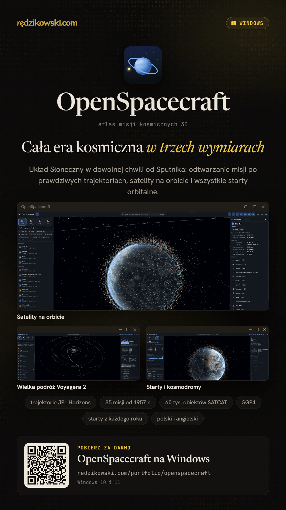

# OpenSpacecraft — atlas misji kosmicznych 3D

<!-- posters:start -->
<p align="center">
  
</p>

<p align="center"><a href="https://redzikowski.com/portfolio/openspacecraft">redzikowski.com/portfolio/openspacecraft</a></p>
<!-- posters:end -->

Natywny program dla Windows (Rust, wgpu, egui): trójwymiarowy Układ Słoneczny w dowolnej chwili od startu Sputnika do 2100 r., z bazą misji kosmicznych odtwarzanych po prawdziwych trajektoriach, wszystkimi skatalogowanymi obiektami na orbicie okołoziemskiej i każdym startem orbitalnym od 1957 r.

Jeden plik `OpenSpacecraft.exe` z wbudowanymi danymi (efemerydy, trajektorie, tekstury, gwiazdy). Z internetu pobierany jest tylko katalog satelitów CelesTrak (i aktualizacje programu z redzikowski.com).

## Instalacja

| platforma | plik | uwagi |
| --- | --- | --- |
| Windows 10/11 (64-bit) | `OpenSpacecraft-Setup-<wersja>.exe` | instalator (Program Files, UAC), skróty, deinstalacja z Panelu sterowania, aktualizacje z redzikowski.com |

## Funkcje

### Układ Słoneczny
- Planety wg **VSOP87B**, Księżyc wg **ELP-2000/82** (Meeus), księżyce galileuszowe, Tytan, Fobos i Dejmos, Pluton (elementy JPL), planetoidy i komety – cele misji (elementy JPL SBDB), punkty L1 i L2.
- Parametry fizyczne, osie i obrót ciał z plików symulatora **Orbiter**; uproszczone tekstury Orbitera (Ziemia z chmurami i atmosferą, Księżyc, planety, księżyce Jowisza, Tytan), pierścienie Saturna liczone z rzeczywistych promieni pierścieni (A, B, C, D, F, przerwy Cassiniego i Enckego) z cieniem planety.
- 9 tys. gwiazd z katalogu Yale Bright Star w barwach klas widmowych, orbity ciał, etykiety bez nakładania się.
- Kamera wokół dowolnego celu z płynnymi przelotami, od kilkudziesięciu metrów do skali całego Układu; odwrócona głębia i współrzędne względem kamery (f64 → f32) – bez drgań przy dowolnej skali.

### Misje
- 85 misji od Sputnika do Artemis II: załogowe, stacje, księżycowe, planetarne, komety i planetoidy, słoneczne, obserwatoria – z opisem, osiągnięciami i przebiegiem (wydarzenia z datą co do minuty) po polsku i angielsku.
- **Rzeczywiste trajektorie z JPL Horizons** dla 49 sond (Voyagery, Pioneery, Galileo, Cassini, New Horizons, Juno, Rosetta, MESSENGER, Dawn, Parker, JWST, Artemis I i II, łaziki marsjańskie…), interpolowane wielomianem Hermite'a; fazy orbitalne krótsze od odstępu próbek odtwarzane propagacją Keplera.
- **Model fizyczny** dla pozostałych (Wostok, Apollo, Łuna, Chang'e…): wznoszenie z kosmodromu, orbita parkingowa, łuki Keplera z zagadnienia Lamberta między rzeczywistymi położeniami ciał, hiperbole przelotów i przechwycenia, orbita wokół celu, lądowanie, start z Księżyca, powrót.
- Odczyty na żywo: czas misji, odległość od Ziemi i Słońca, wysokość i prędkość względem najbliższego ciała, opóźnienie sygnału; bieżąca orbita wokół ciała, wydarzenia na trasie i na osi czasu.

### Satelity i starty
- Katalog **SATCAT** (ok. 69 tys. obiektów) i aktualne elementy **GP** z CelesTrak: satelity aktywne liczone **SGP4**, pozostałe (także historyczne) po orbitach odtworzonych z katalogu – na orbicie widać populację z dowolnego dnia od 1957 r.
- Filtry: rodzaj (satelity, człony rakiet, odłamki), orbita (LEO, MEO, GEO, HEO), grupy (Starlink, OneWeb, GNSS, stacje, meteo), wyszukiwanie po nazwie i numerze NORAD; wykresy liczby obiektów na orbicie i startów w latach.
- Zakładka **Starty**: wszystkie starty orbitalne wybranego roku (z katalogu, grupowane po numerze COSPAR), ranking i znaczniki kosmodromów na globie, odtworzenie startu jednym kliknięciem.

### Interfejs
Wygląd jak w [GRANI](https://redzikowski.com/portfolio/gran-3d): ciemne szkło z rozmyciem nad sceną, jeden akcent. Oś czasu z tempem od czasu rzeczywistego do kilku lat na sekundę (także wstecz), paleta wyszukiwania (`Ctrl+K`), skróty klawiszowe (`F1`), wysoki kontrast, skala interfejsu, polski i angielski. Zgłoszenia błędów i raporty o awariach trafiają do autora przez redzikowski.com.

## Dane na dysku

```text
%APPDATA%\OpenSpacecraft\settings.json          ustawienia
%LOCALAPPDATA%\OpenSpacecraft\cache\             katalog SATCAT i elementy GP (odświeżane co 12 h / 3 dni)
%LOCALAPPDATA%\OpenSpacecraft\openspacecraft.log dziennik
```

## Budowanie

```bash
cargo build --release
cargo test
```

Wydania robi GitHub Actions (`.github/workflows/build.yml`): push na `main` z nową wersją w `Cargo.toml` → testy, kompilacja, podpis, instalator NSIS, `latest.yml` i wydanie.

Trajektorie JPL Horizons odświeża `python tools/fetch_horizons.py` (zapisuje `assets/trajectories.bin`). Zrzuty ekranu: `tools/capture.sh`.

## Źródła danych

Zob. [THIRD-PARTY.md](THIRD-PARTY.md): NASA/JPL Horizons i SBDB, VSOP87, ELP-2000/82, Orbiter (MIT), Yale Bright Star Catalogue, CelesTrak.

---

Pomysł i wykonanie: Adam Rędzikowski · [redzikowski.com](https://redzikowski.com) · [Postaw kawę](https://buycoffee.to/adamredzikowski)
